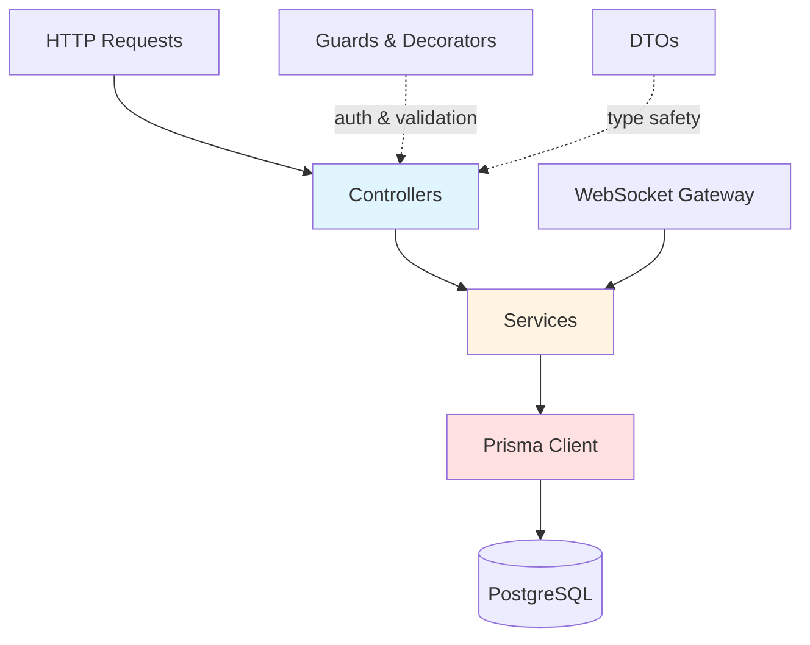

# Layered / N-tier Architecture

## Description

Classic 3-layer architecture implementation: **Presentation** (Controllers) → **Business Logic** (Services) → **Data Access** (Prisma). Each layer depends only on the one below. No dependency inversion or abstraction layers — services call Prisma directly, controllers call services directly.

This is the baseline implementation against which all other architectures will be compared.

## Architecture Diagram



**Layer Responsibilities:**
- **Controllers**: HTTP routing, validation (class-validator), authentication (guards), response formatting
- **Services**: Business logic, orchestration, transaction management
- **Data Access**: Prisma queries, database operations

## What's Interesting Here

### Observed Strengths
- **Extremely fast to build**: No architectural ceremony, just write the feature
- **Widely understood**: Junior devs onboard in hours, not days
- **Low boilerplate**: One service method = one feature, no ports/adapters/use cases
- **Framework leverage**: NestJS DI and decorators feel natural here
- **Great for CRUD**: Straight line from HTTP → service → database

### Observed Weaknesses  
- **Testing friction**: Services are tightly coupled to Prisma — unit tests require mocking the entire Prisma client
- **Business logic leaks**: No enforcement of where logic goes (found myself putting validation in both controllers and services)
- **Refactoring cost**: Swapping Prisma for another ORM touches every service file
- **No domain model**: Entities are Prisma types, not rich domain objects
- **WebSocket awkward**: Notifications gateway has to inject services, creates circular dependency risks

## Project Structure

```
src/
├── auth/               # Authentication module
│   ├── auth.controller.ts
│   ├── auth.service.ts
│   ├── jwt.strategy.ts
│   ├── jwt-auth.guard.ts
│   └── dto/
├── projects/           # Projects CRUD
│   ├── projects.controller.ts
│   ├── projects.service.ts
│   └── dto/
├── tasks/              # Tasks CRUD + assignment
│   ├── tasks.controller.ts
│   ├── tasks.service.ts
│   └── dto/
├── comments/           # Comments CRUD
│   ├── comments.controller.ts
│   ├── comments.service.ts
│   └── dto/
├── notifications/      # WebSocket gateway
│   └── notifications.gateway.ts
├── database/           # Prisma service (global)
│   ├── database.module.ts
│   └── prisma.service.ts
├── common/             # Shared utilities
│   ├── decorators/
│   └── types/
├── app.module.ts
└── main.ts
```

## How to Add a Feature

**Example**: Adding a "priority" field to tasks

### 1. Update Database Schema
Edit `shared/prisma/schema.prisma`:
```prisma
model Task {
  // ... existing fields
  priority Int @default(0)
}
```

Run migration:
```bash
npx prisma migrate dev --name add_task_priority --schema=../../shared/prisma/schema.prisma
```

### 2. Update DTOs
Edit `src/tasks/dto/task.dto.ts`:
```typescript
export class CreateTaskDto {
  // ... existing fields
  
  @IsInt()
  @IsOptional()
  priority?: number;
}

export class UpdateTaskDto {
  // ... existing fields
  
  @IsInt()
  @IsOptional()
  priority?: number;
}
```

### 3. Update Service (if needed)
Usually no changes needed — Prisma auto-includes new fields.

If you need business logic:
```typescript
// tasks.service.ts
async createTask(userId: string, projectId: string, dto: CreateTaskDto) {
  // Validate priority range
  if (dto.priority && (dto.priority < 0 || dto.priority > 10)) {
    throw new BadRequestException('Priority must be between 0 and 10');
  }
  
  return this.prisma.task.create({
    data: { ...dto, projectId },
  });
}
```

### 4. Write Tests
```typescript
// tasks.service.spec.ts
it('should reject priority > 10', async () => {
  await expect(
    service.createTask('user1', 'proj1', { title: 'Task', priority: 11 })
  ).rejects.toThrow(BadRequestException);
});
```

**Total effort**: 3 files touched, ~15 minutes.

## Running

### Development
```bash
npm install
npm run prisma:generate
npm run start:dev
```

### Production
```bash
npm run build
npm run start:prod
```

### Tests
```bash
npm test              # Unit tests
npm run test:cov      # With coverage
npm run test:e2e      # Integration tests
```

### Docker
```bash
# From repository root
BACKEND=01-layered-ntier docker compose up
```

## When to Use This Architecture

### ✅ Best Fit
- **Small to medium teams** (2-8 developers)
- **CRUD-heavy applications** (admin panels, dashboards, simple SaaS)
- **Tight deadlines** (MVPs, prototypes)
- **Teams new to DDD/Clean Architecture** (low learning curve)
- **Stable, well-known domain** (no complex business rules)

### ❌ Bad Fit
- **Complex business logic** (lots of invariants, aggregates, domain events)
- **Multiple persistence strategies** (frequently swapping databases)
- **Long-term maintainability over speed** (technical debt accumulates faster)
- **Strict test isolation requirements** (mocking Prisma client is tedious)
- **Microservices extraction planned** (tightly coupled layers resist splitting)

### Team Size Sweet Spot
**3-5 developers**. Small enough that everyone understands the whole codebase, large enough to benefit from module separation.

## Performance Characteristics

- **Time to first feature**: ~2 hours (setup + auth + one CRUD module)
- **Time to add CRUD module**: ~30 minutes
- **LOC per use case**: ~50-80 lines (controller + service + DTO)
- **Test setup overhead**: Medium (Prisma mocking required)

## Observed Trade-offs

| Aspect | Score (1-5) | Notes |
|---|---|---|
| Speed to market | ⭐⭐⭐⭐⭐ | Fastest architecture tested |
| Testability | ⭐⭐⭐ | Unit tests require heavy mocking |
| Maintainability | ⭐⭐⭐ | Good for first year, degrades after |
| Flexibility | ⭐⭐ | Hard to swap infrastructure |
| Domain complexity | ⭐⭐ | Anemic domain model |
| Onboarding | ⭐⭐⭐⭐⭐ | Anyone familiar with MVC gets it |

## Related Documentation

- **ADR**: [docs/adrs/0010-backend-layered.md](../../docs/adrs/0010-backend-layered.md)
- **Shared Contracts**: [shared/README.md](../../shared/README.md)
- **API Spec**: [shared/openapi.yaml](../../shared/openapi.yaml)
