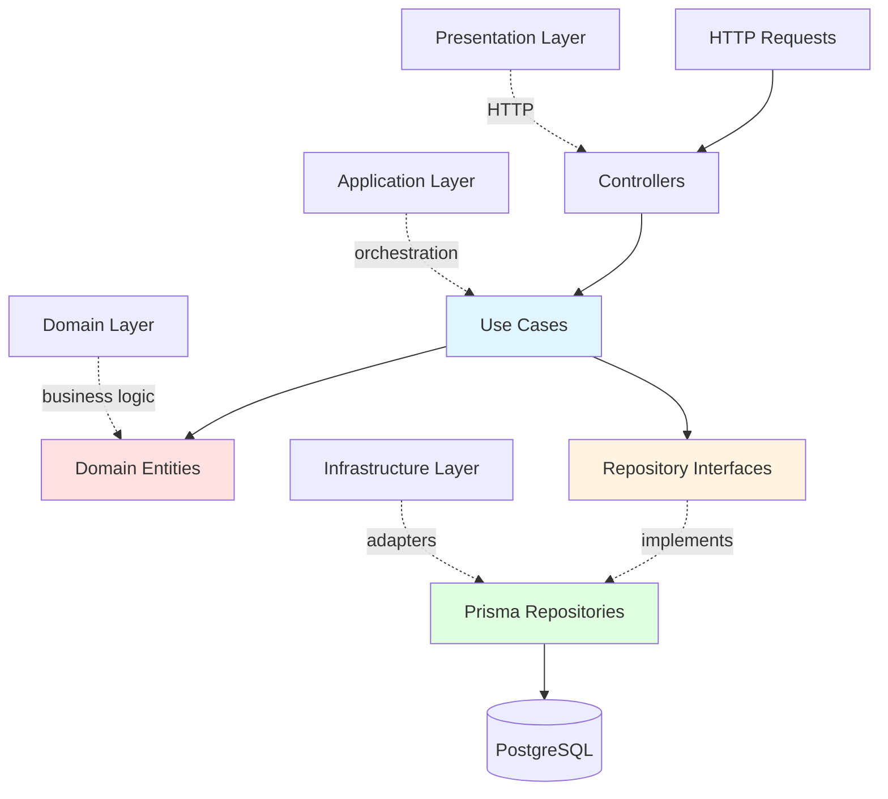

# Clean Architecture

## Description

Clean Architecture implementation with **dependency inversion**, **rich domain entities**, and **clear separation of concerns**. Use cases depend on repository **interfaces** (ports), not concrete Prisma implementations. The domain layer is pure business logic with no framework dependencies.

This implementation contrasts with Backend #1 (Layered) by introducing abstraction layers to improve testability and flexibility.

## Architecture Diagram



**Layer Responsibilities:**
- **Domain**: Entities (User, Project, Task) with business logic + Repository interfaces (ports)
- **Application**: Use cases orchestrating entities and repositories
- **Infrastructure**: Prisma repository implementations (adapters), JWT auth
- **Presentation**: NestJS controllers, HTTP routing, WebSocket gateway

## Key Differences from Backend #1 (Layered)

| Aspect | Layered (Backend #1) | Clean (Backend #2) |
|--------|---------------------|-------------------|
| **Entities** | Anemic (Prisma types) | Rich domain models with methods |
| **Dependencies** | Service → Prisma (concrete) | Use Case → Repository interface |
| **Testability** | Mock entire Prisma client | Mock simple repository interface |
| **Business logic** | Scattered in services | Encapsulated in domain entities |
| **Boilerplate** | Low | Medium (interfaces + adapters) |
| **Framework coupling** | High (Prisma everywhere) | Low (domain is framework-free) |

## Project Structure

```
src/
├── core/
│   ├── domain/               # Pure business logic
│   │   ├── entities/
│   │   │   ├── user.entity.ts
│   │   │   ├── project.entity.ts
│   │   │   └── task.entity.ts
│   │   └── repositories/     # Interfaces (ports)
│   │       ├── user.repository.ts
│   │       ├── project.repository.ts
│   │       └── task.repository.ts
│   └── application/          # Use cases + DTOs
│       ├── use-cases/
│       │   ├── register.use-case.ts
│       │   ├── login.use-case.ts
│       │   ├── create-project.use-case.ts
│       │   ├── list-projects.use-case.ts
│       │   ├── create-task.use-case.ts
│       │   └── assign-task.use-case.ts
│       └── dtos/
├── infrastructure/           # Framework adapters
│   ├── prisma.service.ts
│   ├── auth/
│   │   ├── jwt.strategy.ts
│   │   └── jwt-auth.guard.ts
│   └── repositories/         # Concrete implementations
│       ├── prisma-user.repository.ts
│       ├── prisma-project.repository.ts
│       └── prisma-task.repository.ts
└── presentation/             # HTTP layer
    ├── auth/
    │   ├── auth.controller.ts
    │   └── auth.module.ts
    ├── projects/
    │   ├── projects.controller.ts
    │   └── projects.module.ts
    └── tasks/
        ├── tasks.controller.ts
        └── tasks.module.ts
```

## Running

### Development
```bash
npm install
npm run prisma:generate
cp ../../node_modules/.prisma node_modules/.prisma -r  # Copy generated client
npm run start:dev
```

### Production
```bash
npm run build
npm run start:prod
```

### Tests
```bash
npm test              # Unit tests
npm run test:cov      # With coverage
```

## Observed Trade-offs

### ✅ Pros (vs Layered)

1. **Testability is Night and Day**  
   Use case tests mock a 4-method interface, not 20+ Prisma methods. Test setup went from ~30 lines to ~10 lines.

2. **Business Logic Has a Home**  
   \`Project.isOwnedBy(userId)\`, \`Task.complete()\` — logic lives in entities, not scattered across services.

3. **Swapping Persistence is Trivial**  
   Replace Prisma with TypeORM? Write new adapters, use cases unchanged. Backend #1 would touch every service file.

4. **Domain is Framework-Free**  
   \`core/domain\` has zero imports from NestJS or Prisma. Pure TypeScript business logic.

5. **Onboarding is Structured**  
   New devs learn: Entities → Use Cases → Controllers. Clear mental model.

### ❌ Cons (vs Layered)

1. **Boilerplate Overhead**  
   ~40% more code than Backend #1 for the same features. Every entity needs:
   - Domain model
   - Repository interface
   - Repository implementation
   - Mapper logic (Prisma ↔ Domain)

2. **Slower Initial Development**  
   First feature (auth) took ~2.5 hours vs ~1.5 hours in Layered. The abstraction layers slow you down early.

3. **Redundant Mapping**  
   PrismaProject → Domain Project → DTO. Three representations of the same data.

4. **Overkill for CRUD**  
   Simple list/create/update operations feel over-engineered. The abstractions pay off for complex business logic, but 80% of this app is CRUD.

5. **Team Training Required**  
   Junior devs struggle with "why do we need interfaces?" Layered is intuitive, Clean requires buy-in.

## When to Use Clean Architecture

### ✅ Best Fit

**Complex business domains**  
E-commerce pricing rules, booking constraints, financial calculations — domain logic needs a home.

**Long-term codebases (5+ years)**  
The abstraction layers pay for themselves when requirements change and you're swapping databases or adding new channels.

**Test-driven teams**  
If your team writes tests first, Clean Architecture's mockability is a superpower.

**Microservices preparation**  
Use cases are natural service boundaries. Extracting microservices is straightforward.

### ❌ Bad Fit

**MVPs and prototypes**  
The upfront cost is too high when you don't know if the product will survive.

**Simple CRUD apps**  
Admin panels, dashboards — Layered is faster and good enough.

**Teams new to DDD**  
Clean Architecture assumes domain modeling skills. Start with Layered, graduate to Clean.

## Comparison to Backend #1

| Metric | Layered (#1) | Clean (#2) | Δ |
|--------|-------------|-----------|---|
| **Time to first feature** | 1.5h | 2.5h | +67% |
| **LOC per use case** | ~60 | ~100 | +67% |
| **Test setup lines** | ~30 | ~10 | **-67%** |
| **Files per feature** | 3-4 | 6-7 | +75% |
| **Framework coupling** | High | Low | ✅ |
| **Business logic location** | Scattered | Centralized | ✅ |

**Verdict**: Clean Architecture trades **speed for structure**. Use it when structure matters more than velocity.

## Related Documentation

- **ADR**: [docs/adrs/0011-backend-clean-architecture.md](../../docs/adrs/0011-backend-clean-architecture.md)
- **Backend #1 (Layered)**: [backend/01-layered-ntier/README.md](../01-layered-ntier/README.md)
- **Shared Contracts**: [shared/README.md](../../shared/README.md)
