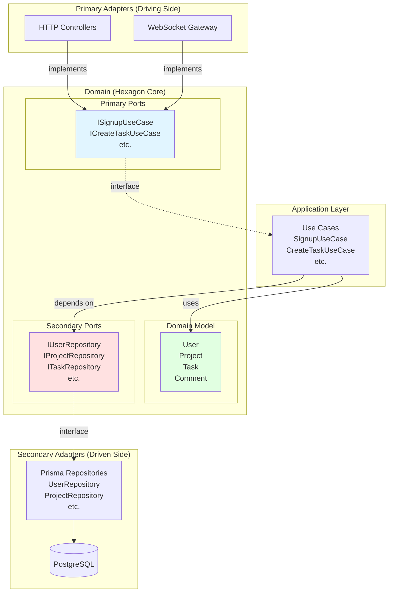

# TaskFlow Backend - Hexagonal Architecture (Ports & Adapters)

This implementation demonstrates the **Hexagonal Architecture** pattern, also known as **Ports and Adapters**.

## Architecture Overview



## Key Hexagonal Concepts

### **The Hexagon (Domain Core)**
- **Domain Model**: Pure business entities (User, Project, Task, Comment)
- **Primary Ports**: Interfaces for use cases (what the app DOES)
- **Secondary Ports**: Interfaces for infrastructure (what the app NEEDS)

### **Primary Adapters (Driving/Input)**
Drive the application by calling primary ports:
- **HTTP Controllers**: REST API endpoints
- **WebSocket Gateway**: Real-time events

### **Secondary Adapters (Driven/Output)**
Implement secondary ports to provide infrastructure:
- **Prisma Repositories**: Database access implementation

### **Application Layer**
- **Use Cases**: Implement primary port interfaces
- Orchestrate domain logic and secondary ports

## Directory Structure

```
src/
├── domain/                         # HEXAGON CORE
│   ├── model/                      # Domain entities
│   │   ├── user.entity.ts
│   │   ├── project.entity.ts
│   │   ├── task.entity.ts
│   │   └── comment.entity.ts
│   └── ports/
│       ├── primary/                # Use case interfaces (driving)
│       │   ├── signup.usecase.interface.ts
│       │   ├── signin.usecase.interface.ts
│       │   ├── create-project.usecase.interface.ts
│       │   ├── create-task.usecase.interface.ts
│       │   └── ...
│       └── secondary/              # Repository interfaces (driven)
│           ├── user.repository.interface.ts
│           ├── project.repository.interface.ts
│           ├── task.repository.interface.ts
│           └── comment.repository.interface.ts
├── application/
│   └── use-cases/                  # Implement primary ports
│       ├── signup.usecase.ts
│       ├── signin.usecase.ts
│       ├── create-project.usecase.ts
│       ├── create-task.usecase.ts
│       └── ...
├── adapters/
│   ├── primary/                    # Driving adapters
│   │   ├── http/                   # NestJS controllers
│   │   │   ├── auth.controller.ts
│   │   │   ├── projects.controller.ts
│   │   │   ├── tasks.controller.ts
│   │   │   └── comments.controller.ts
│   │   └── websocket/              # WebSocket gateway
│   │       └── task-events.gateway.ts
│   └── secondary/                  # Driven adapters
│       └── persistence/            # Prisma implementations
│           ├── prisma.service.ts
│           ├── user.repository.ts
│           ├── project.repository.ts
│           ├── task.repository.ts
│           └── comment.repository.ts
├── app.module.ts                   # Dependency injection wiring
└── main.ts
```

## Dependency Rule

**All dependencies point INWARD to the domain:**

1. **Primary Adapters** → depend on → **Primary Ports** (interfaces)
2. **Use Cases** → implement → **Primary Ports**
3. **Use Cases** → depend on → **Secondary Ports** (interfaces)
4. **Secondary Adapters** → implement → **Secondary Ports**

The domain (hexagon core) has **zero dependencies** on outer layers.

## Ports & Adapters Explained

### Primary Ports (Input)
Interfaces that define what the application can do:
```typescript
// domain/ports/primary/create-task.usecase.interface.ts
export interface ICreateTaskUseCase {
  execute(data: { ... }): Promise<Task>;
}
```

### Primary Adapters
Concrete implementations that drive the app:
```typescript
// adapters/primary/http/tasks.controller.ts
@Controller()
export class TasksController {
  constructor(
    @Inject(ICreateTaskUseCase)
    private readonly createTaskUseCase: ICreateTaskUseCase,
  ) {}

  @Post('projects/:id/tasks')
  async create(...) {
    return await this.createTaskUseCase.execute(...);
  }
}
```

### Secondary Ports (Output)
Interfaces for infrastructure dependencies:
```typescript
// domain/ports/secondary/task.repository.interface.ts
export interface ITaskRepository {
  create(data: { ... }): Promise<Task>;
  findById(id: string): Promise<Task | null>;
  // ...
}
```

### Secondary Adapters
Concrete implementations of infrastructure:
```typescript
// adapters/secondary/persistence/task.repository.ts
@Injectable()
export class TaskRepository implements ITaskRepository {
  constructor(private readonly prisma: PrismaService) {}
  
  async create(data: { ... }): Promise<Task> {
    const task = await this.prisma.task.create({ data });
    return new Task(task);
  }
  // ...
}
```

## Setup & Run

```bash
# Install dependencies
npm install

# Generate Prisma client
npm run prisma:generate

# Run migrations
npm run prisma:migrate

# Start development server
npm run start:dev
```

## Testing the API

```bash
# Signup
curl -X POST http://localhost:3000/auth/signup \
  -H "Content-Type: application/json" \
  -d '{"email":"test@example.com","password":"password123","name":"Test User"}'

# Signin
curl -X POST http://localhost:3000/auth/signin \
  -H "Content-Type: application/json" \
  -d '{"email":"test@example.com","password":"password123"}'

# Get profile (requires token)
curl http://localhost:3000/auth/me \
  -H "Authorization: Bearer YOUR_TOKEN"

# Create project
curl -X POST http://localhost:3000/projects \
  -H "Authorization: Bearer YOUR_TOKEN" \
  -H "Content-Type: application/json" \
  -d '{"name":"My Project"}'
```

## Benefits of Hexagonal Architecture

1. **Technology Independence**: Domain doesn't depend on frameworks
2. **Testability**: Easy to test domain logic in isolation
3. **Flexibility**: Can swap adapters without touching domain
4. **Clear Boundaries**: Explicit ports define contracts
5. **Screaming Architecture**: Structure tells you what the app does

## Comparison to Other Patterns

See ADR `docs/adrs/0012-backend-hexagonal.md` for detailed comparison with Layered and Clean Architecture.
